<div align="center">

# KilnWall

**Your Claude Code sessions, agents and weekly limit, live on the macOS desktop.**
Seven hand-built wallpaper dashboards, fed by one local feed that reads your machine and your `~/.claude` folder.

[Designs](#the-designs) · [How it works](#how-it-works) · [Install](#install) · [Write a design](docs/designing.md) · [Privacy](#privacy-and-the-demo-data) · [Status](#what-is-not-done)

[](https://github.com/yadava5/kiln-wall/actions/workflows/ci.yml)


[](LICENSE)

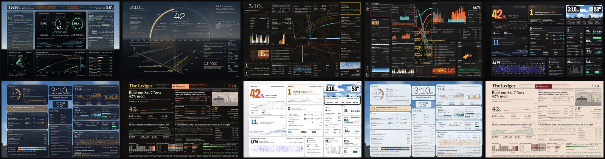

</div>

> Every image and animation here is rendered from a **synthetic, seeded demo feed** (`demo/make-fixture.mjs`). The sessions, repos, the GitHub user `demo-user` and "Demo City" are invented. No real usage data is in this repository; [a CI gate checks that](#privacy-and-the-demo-data).

KilnWall replaces the desktop picture with a web page drawn behind your windows. It shows what Claude Code is doing:
- which sessions are open, working, or **waiting on you** (and what they asked);
- which agents are out, and for how long;
- how much of the week's limit is gone, and when it runs out at the current pace;
- tokens by the minute, the hour and the fortnight.

Around that it shows the machine (CPU per core, memory pressure, network, disk, battery), the weather, and your GitHub year. When a window covers the desktop the page stops; when the desktop shows again the page resumes, with no blank frame.

## The designs

Each design is a folder of HTML, SVG and JavaScript with its own type, palette and idea. Designs switch live from the menu bar. Glass, Bento and Ledger also come in a light look: *auto* follows the sun, or the menu pins one.

| | |
|---|---|
| 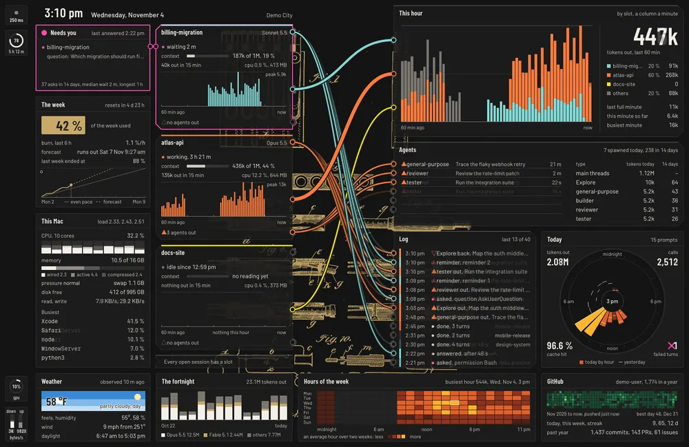 **Patchbay**<br>A modular-synth patch panel printed like Riso on black paper. Cords carry each session's numbers from its module to the panels that count them. | 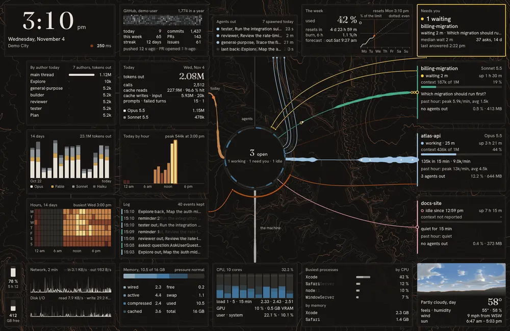 **Mission Map**<br>Smoked-graphite panels over lit terrain contours. Sessions and agents are threads into a central dial, and links between panels route through its rim. |
| 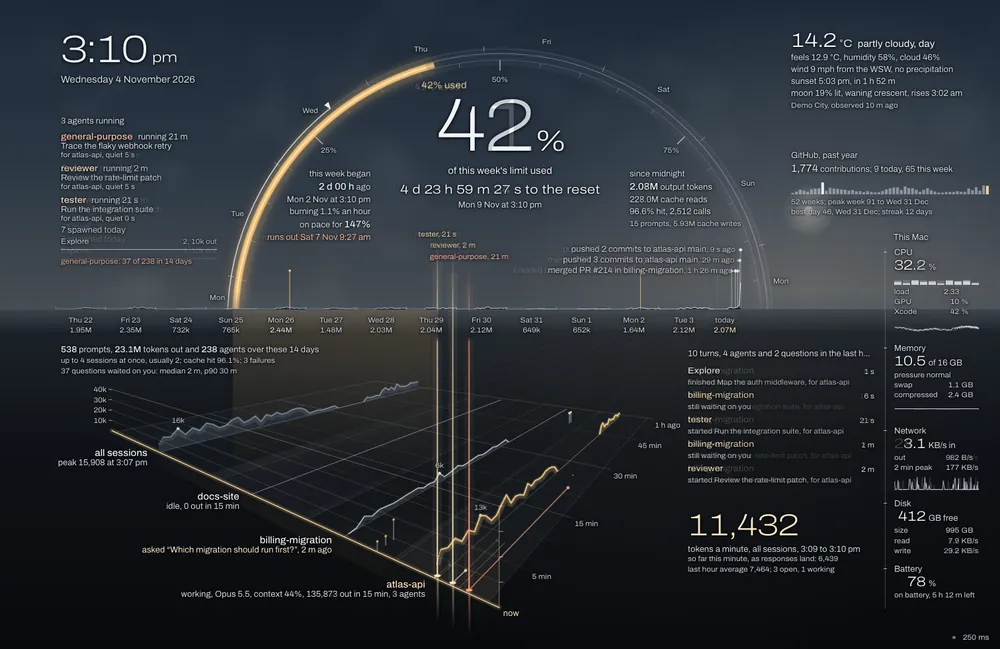 **Horizon**<br>The week's limit as a sun arc over a horizon of the last fourteen days. The last hour is a perspective floor, with one line per session running toward *now*. | 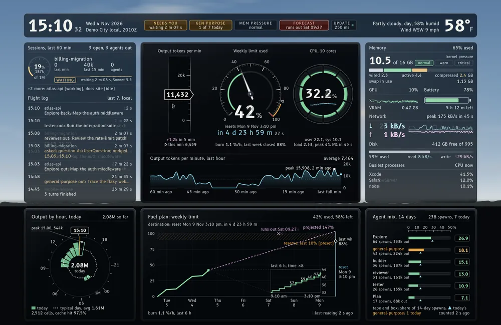 **Flight Deck**<br>A glass cockpit in B612, with Airbus ECAM colour logic: green running, cyan target, amber caution, magenta forecast, red failure. |
| 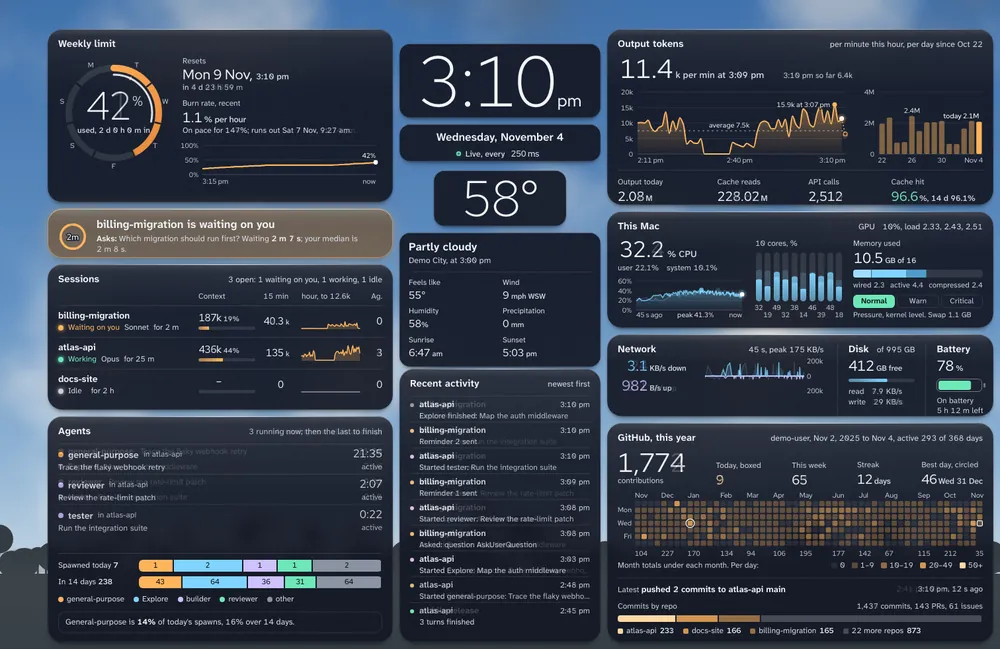 **Glass Control Room** (dark)<br>Frosted panes over a painted sky that follows the real sun and weather. | 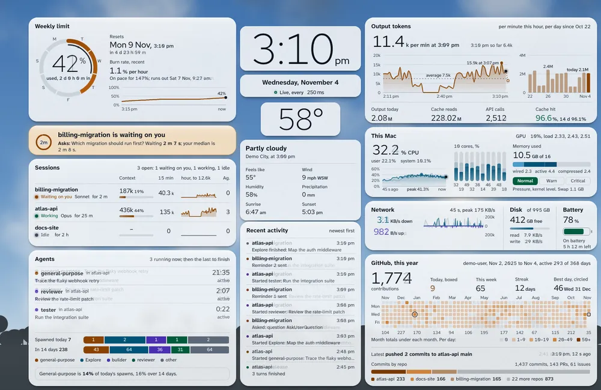 **Glass Control Room** (light)<br>The same room by day. |
| 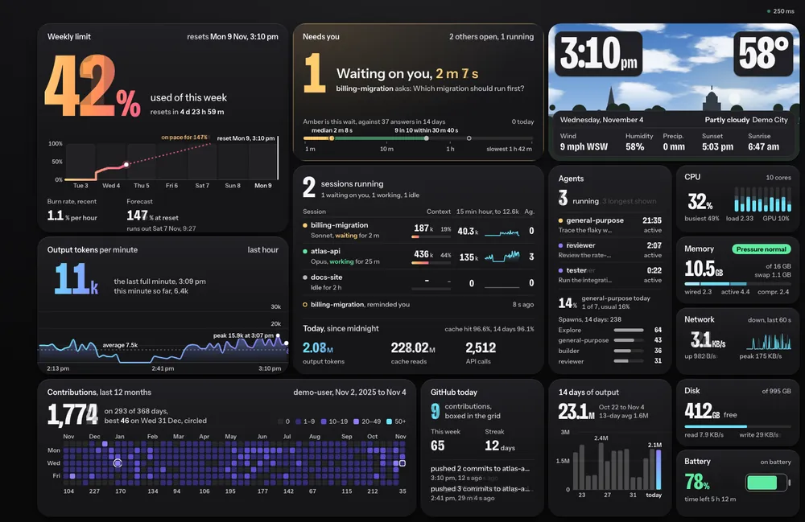 **Bento Keynote** (dark)<br>A keynote-slide bento grid, with the contrast of every ink measured against its tile. | 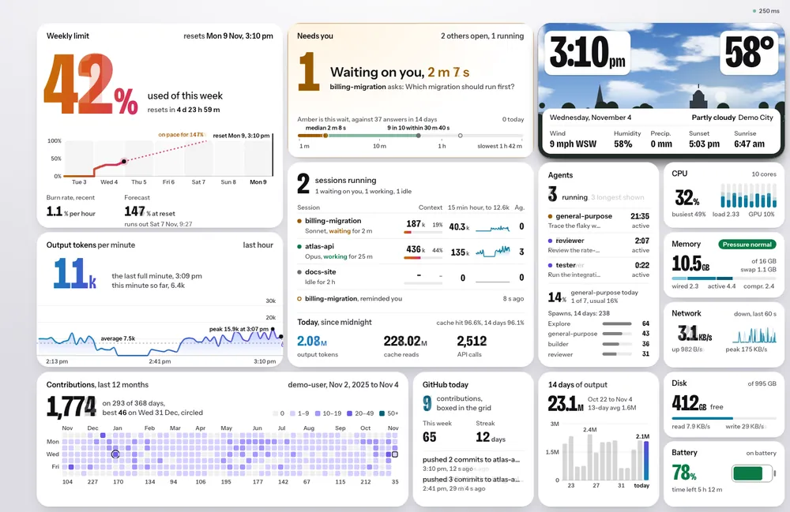 **Bento Keynote** (light) |
| 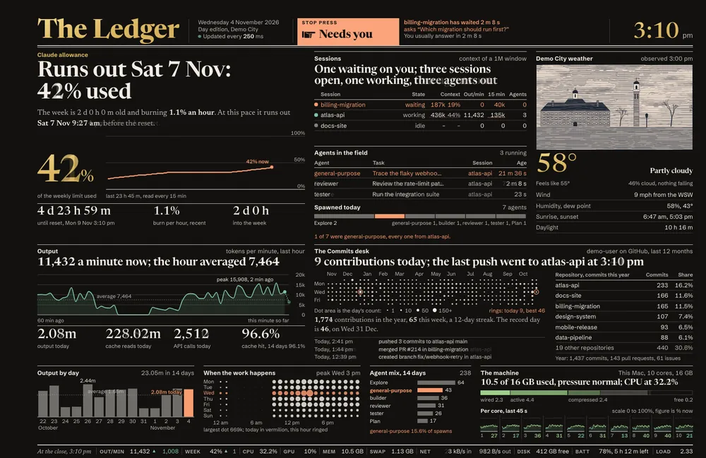 **The Ledger** (dark)<br>A broadsheet in Newsreader. The weather is an engraved plate, and the edition's name follows the sun. | 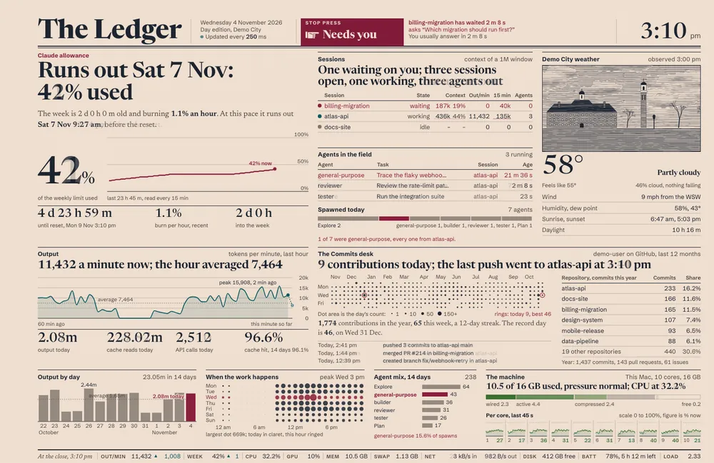 **The Ledger** (light) |

A 1512×982 still of every look is in [`docs/media/`](docs/media/), and an 11-second 1512×982 video of each is attached to the [latest release](https://github.com/yadava5/kiln-wall/releases/latest). All of them were captured frame by frame from the demo feed with `npm run media`.

## How it works

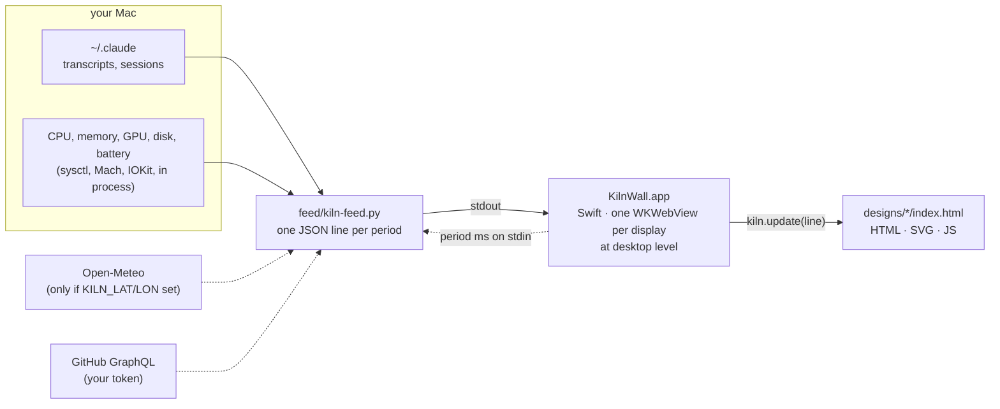

- **`feed/kiln-feed.py`** is a stdlib-only Python process. It prints one JSON snapshot per period: 100 ms to 1 s, live-adjustable.
  - It tails Claude Code's transcripts by byte offset, so it never re-reads a file.
  - It reads machine statistics in process (sysctl, Mach, IOKit). It forks only `ps` and `netstat`, each on its own slower phase.
  - Measured on 2026-11-04 (M1 Pro, `--stream` at 1 Hz, six live sessions, 60 s): **0.67% of one core and 27 MB RSS**. The method is in the file's header, and every line reports the feed's own cost in its `feed` block.
- **`KilnWall.app`** (`Sources/`, about 5,700 lines of Swift) puts one borderless window per display just under the desktop icons, and passes each feed line to the page as text.
  - It suspends the page and the feed when the desktop is covered.
  - It keeps the macOS desktop picture matched to the live page. Mission Control and Space switches animate the system picture, not the window, so a stale picture would flash.
  - It sends the page the Dock's live position, so designs can keep clear of it.
- **A design** is a folder: `index.html`, plus whatever it needs. Shared code is in `designs/_shared/kiln-runtime.js`, which parses lines and exposes `Kiln.state`, formatters, the sun and appearance, the Dock rectangle, and pause/resume. The design contract, the full feed schema and the performance rules are in **[docs/designing.md](docs/designing.md)**.
- **The menu-bar panel** picks the design, the refresh period, light/dark/auto and °F/°C.

## Install

Requirements:
- macOS 14 or later;
- the Xcode command-line tools (`xcode-select --install`), for `swiftc`;
- the system `/usr/bin/python3`.

```sh
git clone https://github.com/yadava5/kiln-wall.git
cd kiln-wall
scripts/install.sh
open ~/Applications/KilnWall.app
```

`install.sh` builds the app into `~/Applications`, and copies `designs/` and `feed/` to `~/.config/kiln-wall/`. **It never overwrites an existing copy there**: those folders are yours to edit. The app is ad-hoc signed by your own build, not notarized.

Optional parts of the feed. Each block reads `null`, and its panel shows an idle state, until you set it up:

| Block | How to turn it on |
|---|---|
| Weather | `launchctl setenv KILN_LAT 40.71; launchctl setenv KILN_LON -74.01; launchctl setenv KILN_PLACE "New York"`, then relaunch the app. (Apps opened from Finder do not see shell variables.) |
| GitHub | `gh auth login`. The feed asks `gh auth token` once. Or set `GH_TOKEN`. `KILN_GITHUB=0` turns it off. |
| Weekly limit | The feed reads plan-limit records from `~/.claude/cache/ratelimits.d/`, written by a Claude Code statusline script. The one in [kiln](https://github.com/yadava5/kiln) (`claude/statusline.sh`) writes them. Without one, the limit panels show no reading. |

Every variable is documented at the top of [`feed/kiln-feed.py`](feed/kiln-feed.py).

## Working on a design without the app

The designs run in any Chromium against the demo feed:

```sh
npm ci
npx playwright-core install chromium-headless-shell
npm run fixture     # regenerate designs/_shared/fixture.js (deterministic: same seed, same bytes)
npm run errcount    # every look replays the fixture; exits 1 on any page or console error
npm run stills      # 1512×982 @2× PNGs of every look
npm run media       # the README loops and the release videos (needs ffmpeg, ImageMagick, img2webp)
```

Or open a design straight from disk, e.g. `designs/patchbay/index.html?fixture&period=250`. `?fixture&still=130` freezes it on one line.

The app itself has a headless mode for exact measurements:

```sh
K=~/Applications/KilnWall.app/Contents/MacOS/KilnWall
$K --snapshot out.png --design glass --appearance dark
$K --measure 40 --design missionmap --period-ms 300
```

Either leaves a running wallpaper alone.

`--measure` reports the CPU the page cost in WebContent and the GPU process.

## Performance

The rule every design is held to (from [docs/designing.md](docs/designing.md)) is **WebContent ≤ 3% of one core at a 300 ms period, and ≤ 150 MB**, measured with `KilnWall --measure` against a reference design in the same batch.

Honest status: measured on an M1 Pro MacBook Pro 14 under ordinary desktop load in November 2026, most designs land at **about 3–5% at 300 ms**. So several are over the line, and readings move by about a point with system load. The animation that puts them over is deliberate. Whether the line should be 3% or about 4.5% is an open decision. These numbers are not re-measured in CI, because a shared CI virtual machine's CPU readings say nothing about a desktop Mac's.

## Privacy and the demo data

- **The feed is local.**
  - It reads `~/.claude` and machine statistics.
  - It sends exactly two optional requests: the coordinates you set, to Open-Meteo, and your own token's query, to GitHub.
  - The page loads only local files.
- **The demo feed is synthetic.** `designs/_shared/fixture.js` is generated by `demo/make-fixture.mjs` from a fixed seed, with the same schema as the real feed and invented values. CI regenerates it and fails if a byte differs.
- **A scrub gate guards the repository.** `scripts/scrub-check.sh` fails on:
  - home-directory paths;
  - e-mail addresses;
  - a hashed denylist of real session, project and agent names;
  - any feed fixture that carries the markers of a real capture.

  CI runs it, then plants a violation and checks that the gate fails. A gate nobody has watched fail is not a gate.

## What is not done

- **No notarized release.** You build it yourself with `scripts/install.sh`. It is ad-hoc signed by your own toolchain, not by a developer ID.
- **Tuned for one screen size.** Every design is laid out and checked at 1512×982 points, a 14-inch MacBook Pro. It runs on any display (one window each), but other sizes are not checked.
- **Performance is over budget** on several designs (see [Performance](#performance)).
- **The weekly-limit panels need a statusline script** to record plan limits. The feed does not call any Anthropic API.
- **Apple Silicon only, as tested.** `build.sh` targets the host architecture; Intel is untested.

## Layout

```
Sources/            the app: windows per display, feed child process, menu panel, headless --snapshot/--measure
page/               the fallback page shown if no design folder exists
designs/            the seven designs, plus _shared/ (runtime, synthetic fixture, dev tools)
feed/               kiln-feed.py and its samplers (kiln-sample.py)
demo/               the fixture generator and the render / error-count tools
docs/               designing.md (the design contract and feed schema), media/
scripts/            install.sh, scrub-check.sh
```

## Credits and licence

Code: [MIT](LICENSE). The fonts (all SIL OFL 1.1), the terrain data and the reference photographs keep their own terms; they are listed in **[CREDITS.md](CREDITS.md)**.

Built by Ayush Yadav. Related: [kiln](https://github.com/yadava5/kiln), the kitty terminal setup and statusline this grew out of.
